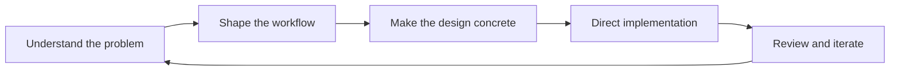

# Kenny Lim
### Product-led founder. Turning messy workflows into usable software.

I come from a non-engineering background. My work starts with the customer problem: what needs to become clearer, simpler or easier to do? I shape the workflow and design direction, then use AI-assisted development to turn that direction into working software.

This portfolio shows how I think across **product, design and technical execution**. Each project explains the problem, the decisions and the current limits alongside the implementation.

## Selected work

| Product | Problem I’m working on | Explore |
| --- | --- | --- |
| **Kenny Canvas** | Turn scattered references into a visual brief people can discuss | [Working canvas prototype](https://github.com/kennylimkamho/kenny-canvas) |
| **Kenny OS** | Keep decisions, research and project context reusable across work sessions | [Personal context management starter](https://github.com/kennylimkamho/kenny-os-context) |
| **Product Design Systems** | Turn product judgment into consistent rules, components and interaction patterns | [ChatDaddy + BobWork case studies](https://github.com/kennylimkamho/design-system) |

## How I build

- **Product judgment:** make the use case and the tradeoffs explicit before expanding scope.
- **Design direction:** document the hierarchy, interaction states and reusable patterns that make an experience coherent.
- **Technical execution:** work with AI coding tools, inspect implementation and keep product claims tied to what actually works.
- **Context as infrastructure:** retain the reasoning behind decisions so each work session starts with useful background.

The public repositories contain prototypes, reusable examples and product documentation. They are evidence of the work and its current state; they are not claims of customer traction or fully launched commercial products.

Start with a project above to see the thinking and the implementation together.
